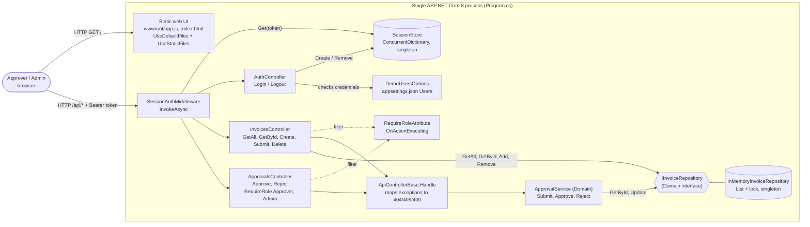
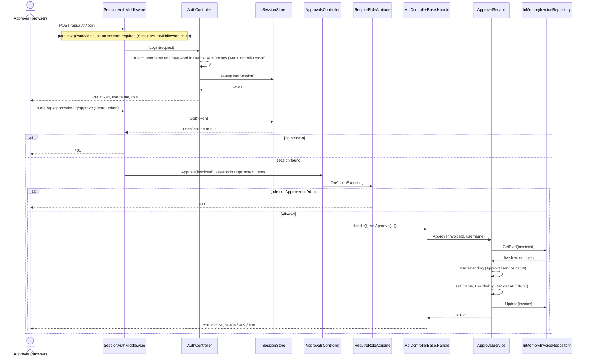

# As-built architecture (code as of this commit)

Rendered images: [container view](diagrams/as-built-container.png), [sequence](diagrams/as-built-sequence.png)

Everything here is read from `backend/src`. Nothing from `ops/` is used, because `ops/` describes the planned deployment. Every element cites a file and line; anything not directly shown in code is listed under "Inferred".

## Container view

| Element | Citation |
| --- | --- |
| Static web UI | `Program.cs:19-20` (`UseDefaultFiles`, `UseStaticFiles`); `wwwroot/app.js:19` calls `fetch('/api...')` with `Authorization: Bearer` at `:18` |
| `SessionAuthMiddleware` | `Auth/SessionAuthMiddleware.cs:4`, `InvokeAsync` at `:16`, registered at `Program.cs:21` |
| `SessionStore` | `Auth/SessionStore.cs:7`, `ConcurrentDictionary` at `:9`, singleton at `Program.cs:13` |
| `AuthController` | `Controllers/AuthController.cs:9`, `Login` `:24`, `Logout` `:39` |
| `DemoUsersOptions` | `Auth/UserSession.cs:12`, bound at `Program.cs:12`, values in `appsettings.json:9-12` |
| `InvoicesController` | `Controllers/InvoicesController.cs:9`; `Delete` has `[RequireRole("Admin")]` at `:73` |
| `ApprovalsController` | `Controllers/ApprovalsController.cs:10`, class-level `[RequireRole("Approver", "Admin")]` at `:9` |
| `RequireRoleAttribute` | `Auth/RequireRoleAttribute.cs:8`, `OnActionExecuting` `:17` |
| `ApiControllerBase.Handle` | `Controllers/ApiControllerBase.cs:9` |
| `ApprovalService` | `Domain/ApprovalService.cs:7`, `Submit` `:16`, `Approve` `:31`, `Reject` `:43`; scoped at `Program.cs:15` |
| `IInvoiceRepository` | `Domain/IInvoiceRepository.cs:3` |
| `InMemoryInvoiceRepository` | `Api/InMemoryInvoiceRepository.cs:6`, `_lock` `:8`, `List<Invoice>` `:11`; singleton at `Program.cs:14` |

## Sequence: sign in, then approve

## Inferred (not directly shown in code)

- The process is a single instance. The code never states it. The in-process `lock` and singleton registrations only work correctly for one instance, and nothing configures scale-out.
- `GetById` returns the stored object itself, so `Approve` mutates the repository's own instance before `Update` is called. This follows from `List<Invoice>` holding references (`InMemoryInvoiceRepository.cs:25-28`), and I did not run it to confirm.
- Two concurrent `Approve` calls on the same invoice can both pass `EnsurePending`. This is a reading of `ApprovalService.cs:33-39`, not a test result.
- Tokens never expire. This is inferred from the absence of any expiry in `SessionStore`, so it is a claim about missing code.
- No logging, audit trail, health endpoint, or HTTPS redirect exists. This is based on a search of `Program.cs` and the services, so it is an absence claim.
- The browser keeps the token in `sessionStorage` (`wwwroot/app.js:4`, `:108`).

## Corrections to what the agent first reported

An earlier exploration pass was checked against the code. These claims were wrong or misleading, and are corrected here.

| Earlier claim | What the code shows |
| --- | --- |
| `FakeInvoiceRepository` lives under `backend/src/InvoiceApp.Tests` | It is under `backend/tests/InvoiceApp.Tests/FakeInvoiceRepository.cs`. `Update` is a no-op there (`:15`), which is true. |
| `Program.cs:10` reads the demo users | It is `Program.cs:12`. |
| Eval cases 03 and 08 modify `DiscountCalculator.Apply` and a `ConcurrentDictionary` repository | The real `DiscountCalculator` is an instance class with `ApplyDiscount` (`Domain/DiscountCalculator.cs:31`), and the real repository is `List<Invoice>` plus `lock`. The case diffs do not apply to this tree. Treat them as stand-alone snippets. |
| "ToZero is banker's rounding" | `MidpointRounding.ToZero` truncates. Banker's rounding is `ToEven`. |
| The incident packs describe code in this repo | `PayExClient`, Service Bus publishing and the notification worker do not exist in `backend/`. They are the planned system. |
| `ApprovalService` has event hooks that are missing | True, but only in the sense that nothing publishes events. The class has no dependency except `IInvoiceRepository`. |
| The CI pipeline takes about 35 to 42 minutes | Summing `ops/pipeline/run-timings.csv` gives a mean of 31.3 minutes and a range of 28.4 to 35.1 (see [baseline.md](../measurement/baseline.md)). |

## Architecture test

Rule, from `AGENTS.md`: business rules live in the Domain project, with no web or storage code. It is encoded in [ArchitectureTests.cs](../../backend/tests/InvoiceApp.Tests/ArchitectureTests.cs): the Domain assembly must not reference `InvoiceApp.Api`, ASP.NET Core, Entity Framework, SQL client or Service Bus assemblies.

Command: `dotnet test backend/InvoiceApp.sln --filter ArchitectureTests`

**Status: run and passing.** On 2026-10-24, with .NET SDK 8.0.426 installed user-local, `dotnet test backend/InvoiceApp.sln --filter ArchitectureTests` gave `Passed: 1, Failed: 0`, and the full suite gave `Passed: 8, Failed: 0`.

**Failure case demonstrated.** With `<FrameworkReference Include="Microsoft.AspNetCore.App" />` added to `InvoiceApp.Domain.csproj` and a property of type `Microsoft.AspNetCore.Http.HttpContext` added to `Invoice`, the test failed with `InvoiceApp.Domain must not reference: Microsoft.AspNetCore.Http.Abstractions` (`Failed: 1, Passed: 0`). Both changes were then reverted and the full suite passed again (8 of 8), with `git status` showing only the new test file. To repeat it, make the same two edits, run the command above, and revert.

Limit to keep in mind: the test only sees assemblies the compiler actually references, so an unused package reference would not trip it. Also, `dotnet` is installed at `~/.dotnet`, so in a new terminal run `export PATH="$HOME/.dotnet:$PATH"` first.
