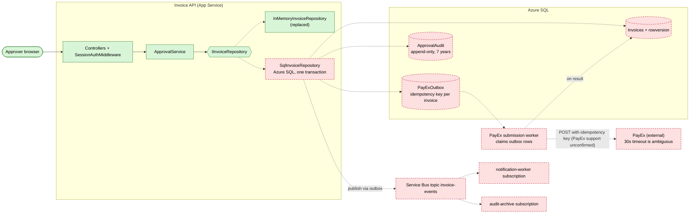

# Target state (planned, not built)

Rendered image: [diagrams/target-state.png](diagrams/target-state.png)

Solid green boxes exist in the code today (see [as-built.md](as-built.md)). Red dashed boxes do not exist anywhere in `backend/`. They come from the brief and from the `ops/` evidence packs, which describe the planned deployment.

## What is planned, and where it comes from

| Planned element | Status | Source |
| --- | --- | --- |
| Azure SQL persistence | Not built. Repository is in-memory. | Brief; `InMemoryInvoiceRepository.cs:6` is the only implementation |
| Audit table, 7-year retention | Not built. Only `DecidedBy` and `DecidedAt` on `Invoice` (`Domain/Invoice.cs:10-11`) | Brief (SOC 2) |
| Outbox table and worker | Not built, and not yet decided. The decision record picks the design | `docs/adr/0001-exactly-once-payex-submission.md` |
| PayEx client | Not built. The only trace is the deploy diff in `ops/incidents/INC-2041/deploy-diff.patch`, which describes a client that does not exist in this repo | Brief; INC-2041 |
| Service Bus topic and subscriptions | Provisioned in Azure but unused by the code. Names come from `ops/incidents/INC-2047/servicebus-status.txt` | Brief; INC-2047 |
| Optimistic concurrency (`rowversion`) | Not built. `ApprovalService.Approve` has no version check (`Domain/ApprovalService.cs:31-40`) | Gap found in the as-built review |

The unchanged pieces are the controllers, the middleware, `ApprovalService` and the `IInvoiceRepository` seam. That seam is the one place the SQL repository plugs in, so the architecture test in `ArchitectureTests.cs` (run, passing, and shown to fail when the rule is broken; see [as-built.md](as-built.md)) is meant to keep Domain free of web and storage types.

## Citations for the nodes that exist

| Node | Citation |
| --- | --- |
| Approver browser | `wwwroot/app.js:19` (`fetch('/api...')` with a bearer token) |
| Controllers + `SessionAuthMiddleware` | `Program.cs:21-22`; `Auth/SessionAuthMiddleware.cs:16`; `Controllers/ApprovalsController.cs:10`, `InvoicesController.cs:9` |
| `ApprovalService` | `Domain/ApprovalService.cs:7`; registered at `Program.cs:15` |
| `IInvoiceRepository` | `Domain/IInvoiceRepository.cs:3` |
| `InMemoryInvoiceRepository` (to be replaced) | `Api/InMemoryInvoiceRepository.cs:6`; registered at `Program.cs:14` |

## Citations for the nodes that are planned

| Node | Where the evidence is |
| --- | --- |
| Azure SQL (`Invoices`) | The brief (Azure SQL, no persistence today) |
| Service Bus topic `invoice-events` and the `notification-worker` and `audit-archive` subscriptions | `ops/incidents/INC-2047/servicebus-status.txt:5-17` |
| PayEx, 30s ambiguous timeout | The brief; `ops/incidents/INC-2041/deploy-diff.patch` (the client the release added) |
| PayEx submission worker, outbox table, idempotency key | Proposed in `docs/adr/0001-exactly-once-payex-submission.md` |

## Inferred or proposed (not stated by any source)

- The names `SqlInvoiceRepository`, `ApprovalAudit` and `PayExOutbox` are mine. No source names these tables or classes.
- The `rowversion` column on `Invoices` is my proposal to close the check-then-act gap in `ApprovalService.Approve`, which I read from code and did not test.
- Publishing to Service Bus "via outbox" is my design choice. The ADR says not to put the PayEx path on Service Bus, and to publish events from the outbox only if other consumers appear.
- That the notification worker and the audit archive are fed from the same topic comes from INC-2047. That they would be fed from this service's outbox is inferred.
- Whether the worker runs in the App Service or elsewhere is undecided, so the diagram leaves it outside the "Invoice API" box.
